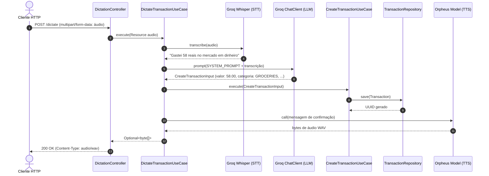

# Speech Processor

API RESTful desenvolvida em Java e Spring Boot para processamento inteligente e gerenciamento de transações financeiras pessoais a partir de comandos de voz (STT/TTS) e texto, utilizando inteligência artificial generativa com Spring AI e a API da Groq.

---

## Sumário

- [Visão Geral](#visão-geral)
- [Tecnologias Utilizadas](#tecnologias-utilizadas)
- [Arquitetura](#arquitetura)
  - [Organização de Pacotes](#organização-de-pacotes)
  - [Camadas e Responsabilidades](#camadas-e-responsabilidades)
  - [Fluxo de Execução: Ditado por Voz](#fluxo-de-execução-ditado-por-voz)
  - [Estratégia de Persistência](#estratégia-de-persistência)
- [Endpoints](#endpoints)
  - [1. Ditado de Transações por Voz](#1-ditado-de-transações-por-voz)
  - [2. Gestão de Transações](#2-gestão-de-transações)
  - [3. Relatórios Financeiros](#3-relatórios-financeiros)
  - [Valores de Domínio (Enums)](#valores-de-domínio-enums)
- [Tratamento de Erros e Resiliência](#tratamento-de-erros-e-resiliência)
- [Configuração e Execução](#configuração-e-execução)
  - [Pré-requisitos](#pré-requisitos)
  - [Clonagem](#clonagem)
  - [Variáveis de Ambiente](#variáveis-de-ambiente)
  - [Banco de Dados (Docker Compose)](#banco-de-dados-docker-compose)
  - [Executando a Aplicação](#executando-a-aplicação)
  - [Executando os Testes](#executando-os-testes)
- [Considerações Adicionais](#considerações-adicionais)

---

## Visão Geral

O **Speech Processor** simplifica e automatiza o registro de receitas e despesas financeiras. Em vez de preencher formulários manuais ou planilhas, o usuário pode enviar um arquivo de áudio com a descrição falada de um gasto ou ganho em português brasileiro (ex.: *"Gastei 58 reais no mercado em dinheiro"*).

A aplicação:
1. Transcreve o áudio em texto via modelo **Whisper Large v3**.
2. Extrai semanticamente os dados estruturados (valor, categoria, tipo da transação e forma de pagamento) por meio de um LLM via **Spring AI**.
3. Registra a transação no banco de dados relacional (MySQL).
4. Sintetiza em áudio uma resposta de confirmação falada (**Text-to-Speech**) retornada diretamente ao cliente.

Além do fluxo por voz, o sistema disponibiliza um CRUD completo de transações e um gerador de relatórios consolidados com cálculo de saldo e filtro por período.

---

## Tecnologias Utilizadas

| Categoria | Tecnologia | Versão / Detalhes | Finalidade |
| :--- | :--- | :--- | :--- |
| **Linguagem** | Java | 27 (OpenJDK) | Linguagem base do projeto |
| **Framework Base** | Spring Boot | 4.1.2 | Estrutura central da aplicação web e injeção de dependências |
| **Framework de IA** | Spring AI | 2.0.0-M4 | Abstração para integração com modelos LLM, STT, TTS e Tool Calling |
| **Provedor de IA** | Groq API | Compatível com OpenAI API | Execução de inferência de baixa latência para chat e transcrição |
| **Modelo STT** | OpenAI Whisper | `whisper-large-v3` | Transcrição de áudio em português para texto |
| **Modelo LLM** | Groq Chat Model | Configurável via `${GROQ_MODEL}` | Extração de entidades e interpretação semântica da transação |
| **Modelo TTS** | Canopy Labs Orpheus | `canopylabs/orpheus-v1-english` | Síntese de áudio WAV para a confirmação falada |
| **Persistência** | Spring Data JPA / Hibernate | Gerenciado pelo Spring Boot | Mapeamento objeto-relacional e consultas |
| **Banco de Dados** | MySQL | 9.6 | Armazenamento relacional dos dados de transações |
| **Infraestrutura Local** | Docker / Docker Compose | Arquivo `compose.yml` | Inicialização automatizada do contêiner MySQL |
| **Build Tool** | Gradle | Wrapper incluído | Compilação, gestão de dependências e execução |
| **Utilitários** | Project Lombok | 9.8.3 (`io.freefair.lombok`) | Redução de boilerplate (getters, construtores) |
| **Validação** | Jakarta Validation | `spring-boot-starter-validation` | Validação de restrições de entrada de dados |
| **Testes** | JUnit 5 / AssertJ | JUnit Platform Launcher | Testes unitários e testes de integração |

---

## Arquitetura

O projeto adota uma arquitetura inspirada nos princípios da **Clean Architecture** e do padrão **Ports and Adapters (Hexagonal)**, mantendo regras de negócio desacopladas de frameworks de apresentação e de persistência.

### Organização de Pacotes

```
dio.speech/
├── SpeechProcessorApplication.java       # Ponto de entrada da aplicação e configuração de beans
├── domain/                               # Núcleo da aplicação (regras de negócio e interfaces puras)
│   ├── Category.java                     # Categorias financeiras disponíveis
│   ├── PaymentMethod.java                # Métodos de pagamento (CASH, CREDIT, DEBIT)
│   ├── Transaction.java                  # Entidade raiz de domínio com invariantes
│   ├── TransactionId.java                # Value Object do identificador da transação
│   ├── TransactionRepository.java        # Porta (interface) de persistência
│   └── Type.java                         # Tipo da transação (INCOME, EXPENSE)
├── application/                          # Orquestração e casos de uso
│   ├── input/                            # DTOs de entrada dos casos de uso
│   │   ├── CreateTransactionInput.java   # Mapeado com @ToolParam para Spring AI
│   │   └── UpdateTransactionInput.java
│   ├── output/                           # DTOs de saída dos casos de uso
│   │   └── ReportOutput.java
│   └── usecase/                          # Implementação dos casos de uso de negócio
│       ├── dictation/
│       │   └── DictateTransactionUseCase.java
│       ├── report/
│       │   └── GetTransactionsReportUseCase.java
│       └── transaction/
│           ├── CreateTransactionUseCase.java          # Anotado com @Tool
│           ├── DeleteTransactionUseCase.java          # Anotado com @Tool
│           ├── GetTransactionByIdUseCase.java         # Anotado com @Tool
│           ├── GetTransactionsByCategoryUseCase.java  # Anotado com @Tool
│           ├── GetTransactionsUseCase.java            # Anotado com @Tool
│           └── UpdateTransactionUseCase.java          # Anotado com @Tool
├── infrastructure/                       # Adaptadores de entrada e saída
│   ├── http/                             # Adaptador HTTP REST (driving adapter)
│   │   ├── DictationController.java      # Endpoint de áudio /dictate
│   │   ├── ReportController.java         # Endpoint de relatórios /reports
│   │   ├── TransactionController.java    # Endpoints de CRUD /transactions
│   │   ├── request/                      # DTOs de requisição HTTP
│   │   └── response/                     # DTOs de resposta HTTP
│   └── persistence/                      # Adaptador de persistência JPA (driven adapter)
│       ├── entity/
│       │   └── TransactionEntity.java    # Entidade mapeada para a tabela MySQL
│       ├── mapper/
│       │   └── TransactionMapper.java    # Conversão entre entidade JPA e domínio
│       └── repository/
│           ├── JpaTransactionRepository.java         # Implementação de TransactionRepository
│           └── SpringDataTransactionRepository.java  # Interface Spring Data JPA
└── shared/
    └── domain/
        └── UniqueId.java                 # Gerador de identificadores UUID
```

### Camadas e Responsabilidades

- **Domínio (`domain`)**: Contém entidades puras e Value Objects livres de anotações de persistência JPA. A classe `Transaction` garante invariantes de negócio (como validação de valores monetários estritamente positivos e nulidade mandatória de método de pagamento para transações do tipo `INCOME`).
- **Aplicação (`application`)**: Coordena fluxos de casos de uso sem acoplamento com o protocolo HTTP. Os casos de uso de transações são anotados com `@Tool`, permitindo que agentes LLM executem Function Calling diretamente sobre os métodos do sistema.
- **Infraestrutura (`infrastructure`)**:
  - `http`: Controladores REST que realizam validação sintática das requisições, chamam os casos de uso e mapeiam os resultados para respostas HTTP e formatos adequados (`audio/wav`, `application/json`).
  - `persistence`: Entidades JPA (`TransactionEntity`), interfaces do Spring Data JPA e implementações de repositório que convertem dados via `TransactionMapper`.

### Fluxo de Execução: Ditado por Voz



### Estratégia de Persistência

- Banco de dados relacional **MySQL**.
- O Hibernate está configurado com `spring.jpa.hibernate.ddl-auto=update`, criando e atualizando automaticamente a tabela `transactions`.
- O isolamento entre domínio e banco de dados é garantido pelo `TransactionMapper`, evitando que detalhes técnicos de infraestrutura contaminem o modelo de domínio.

---

## Endpoints

A aplicação opera por padrão na porta `8080`.

### 1. Ditado de Transações por Voz

#### `POST /dictate`
Processa um arquivo de áudio gravado, transcreve a fala, extrai as informações da transação financeira via IA, persiste o registro no banco de dados e retorna uma confirmação em áudio.

- **Consumes**: `multipart/form-data`
- **Produces**: `audio/wav`
- **Parâmetros**:
  - `file` (*multipart file*, obrigatório): Arquivo de áudio (ex.: `.mp3`, `.wav`, `.m4a`).
- **Respostas**:
  - `200 OK`: Áudio binário WAV contendo a síntese de voz de confirmação.
  - `204 No Content`: Transação não pôde ser interpretada ou gerou resposta vazia.
  - `400 Bad Request`: Arquivo de áudio ausente ou vazio (`INVALID_AUDIO_FILE`).
  - `502 Bad Gateway`: Falha de comunicação ou inferência nos serviços de IA (`EXTERNAL_SERVICE_ERROR`).
  - `500 Internal Server Error`: Erro interno inesperado do servidor.

**Exemplo de requisição (cURL):**
```bash
curl -X POST http://localhost:8080/dictate \
  -F "file=@src/test/resources/audio/01_groceries_cash.mp3" \
  --output confirmacao.wav
```

---

### 2. Gestão de Transações

#### `GET /transactions`
Lista transações registradas, permitindo filtro opcional por categoria.

- **Método**: `GET`
- **Query Parameters**:
  - `category` (*string*, opcional): Filtra pelas transações da categoria especificada (ex.: `GROCERIES`, `FOOD_AND_DINING`).
- **Respostas**:
  - `200 OK`: Lista de transações.

**Exemplo de requisição:**
```bash
curl -X GET "http://localhost:8080/transactions?category=GROCERIES"
```

**Exemplo de resposta (200 OK):**
```json
[
  {
    "id": "7b8f9e6d-5544-48ee-89a3-5c4d6f8a9012",
    "category": "GROCERIES",
    "input": "Gastei 58 reais no mercado em dinheiro",
    "output": "Recorded grocery expense of 58 reais.",
    "amount": 58.00,
    "type": "EXPENSE",
    "paymentMethod": "CASH",
    "createdAt": "2026-11-05T18:30:00Z",
    "updatedAt": null
  }
]
```

---

#### `GET /transactions/{uuid}`
Recupera os detalhes de uma transação específica através do seu identificador único.

- **Método**: `GET`
- **Path Variables**:
  - `uuid` (*UUID*, obrigatório): Identificador único da transação.
- **Respostas**:
  - `200 OK`: Dados da transação encontrada.
  - `404 Not Found`: Nenhuma transação localizada com o UUID fornecido.

**Exemplo de requisição:**
```bash
curl -X GET http://localhost:8080/transactions/7b8f9e6d-5544-48ee-89a3-5c4d6f8a9012
```

---

#### `POST /transactions`
Cria manualmente um novo registro de transação financeira.

- **Método**: `POST`
- **Headers**: `Content-Type: application/json`
- **Corpo da requisição**:
  ```json
  {
    "input": "Almoço em restaurante",
    "output": "Despesa de alimentação registrada",
    "amount": 42.50,
    "category": "FOOD_AND_DINING",
    "type": "EXPENSE",
    "paymentMethod": "CREDIT"
  }
  ```
- **Respostas**:
  - `201 Created`: Transação registrada com sucesso. O cabeçalho `Location` conterá a URI do novo recurso (ex.: `/transactions/7b8f9e6d-5544-48ee-89a3-5c4d6f8a9012`).
  - `400 Bad Request`: Parâmetros inválidos (ex.: `amount` <= 0, campos obrigatórios ausentes).

**Exemplo de requisição:**
```bash
curl -i -X POST http://localhost:8080/transactions \
  -H "Content-Type: application/json" \
  -d '{
    "input": "Salário mensal",
    "output": "Receita registrada",
    "amount": 5000.00,
    "category": "INCOME",
    "type": "INCOME",
    "paymentMethod": null
  }'
```

---

#### `PUT /transactions/{uuid}`
Atualiza o valor monetário e/ou a categoria de uma transação existente.

- **Método**: `PUT`
- **Path Variables**:
  - `uuid` (*UUID*, obrigatório): Identificador da transação a ser modificada.
- **Headers**: `Content-Type: application/json`
- **Corpo da requisição**:
  ```json
  {
    "amount": 65.00,
    "category": "SHOPPING"
  }
  ```
- **Respostas**:
  - `204 No Content`: Transação atualizada com sucesso.
  - `400 Bad Request`: Dados inválidos.
  - `404 Not Found`: Transação não localizada com o UUID informado (`RESOURCE_NOT_FOUND`).

**Exemplo de requisição:**
```bash
curl -i -X PUT http://localhost:8080/transactions/7b8f9e6d-5544-48ee-89a3-5c4d6f8a9012 \
  -H "Content-Type: application/json" \
  -d '{"amount": 65.00, "category": "SHOPPING"}'
```

---

#### `DELETE /transactions/{uuid}`
Exclui uma transação financeira.

- **Método**: `DELETE`
- **Path Variables**:
  - `uuid` (*UUID*, obrigatório): Identificador da transação a ser excluída.
- **Respostas**:
  - `204 No Content`: Transação removida com sucesso.

**Exemplo de requisição:**
```bash
curl -i -X DELETE http://localhost:8080/transactions/7b8f9e6d-5544-48ee-89a3-5c4d6f8a9012
```

---

### 3. Relatórios Financeiros

#### `GET /reports`
Calcula o consolidado financeiro contendo total de receitas (`income`), total de despesas (`expenses`) e saldo líquido (`balance`), com suporte a filtro opcional por período de datas no fuso horário `America/Sao_Paulo`.

- **Método**: `GET`
- **Query Parameters**:
  - `from` (*string formato YYYY-MM-DD*, opcional): Data inicial do período (início do dia).
  - `to` (*string formato YYYY-MM-DD*, opcional): Data final do período (inclusive).
- **Respostas**:
  - `200 OK`: Relatório financeiro consolidado.
  - `400 Bad Request`: Caso `from` seja posterior a `to` (`INVALID_DATE_RANGE`) ou parâmetro de data com formato inválido (`INVALID_PARAMETER_TYPE`).

**Exemplo de requisição:**
```bash
curl -X GET "http://localhost:8080/reports?from=2026-11-01&to=2026-11-30"
```

**Exemplo de resposta (200 OK):**
```json
{
  "balance": 4942.00,
  "income": 5000.00,
  "expenses": 58.00,
  "timestamp": "2026-11-05T19:35:00.123456Z"
}
```

---

### Valores de Domínio (Enums)

| Enum | Valores Aceitos | Observações |
| :--- | :--- | :--- |
| **`Type`** | `INCOME`, `EXPENSE` | Define se é receita ou despesa |
| **`PaymentMethod`** | `CASH`, `CREDIT`, `DEBIT` | Meio de pagamento. Se `Type == INCOME`, o valor é forçado para `null` |
| **`Category`** | `GROCERIES`, `PHARMA`, `AUTO`, `TRANSPORTATION`, `HOUSING`, `UTILITIES`, `FOOD_AND_DINING`, `ENTERTAINMENT`, `SHOPPING`, `HEALTH`, `EDUCATION`, `PERSONAL_CARE`, `SUBSCRIPTIONS`, `TRAVEL`, `PETS`, `CLOTHING`, `TECHNOLOGY`, `INSURANCE`, `TAXES`, `INVESTMENTS`, `INCOME`, `OTHER` | Categoria contábil/financeira da transação |

---

## Tratamento de Erros e Resiliência

A API adota um padrão rigoroso e consistente para comunicação de erros, garantindo transparência ao cliente, rastreabilidade operacional e proteção contra vazamento de dados sensíveis em produção.

### 1. Formato Padrão de Resposta de Erro (`ApiErrorResponse`)

Todas as respostas de erro retornam um JSON padronizado com cabeçalho `Content-Type: application/json` e status HTTP semântico:

```json
{
  "success": false,
  "error": {
    "code": "VALIDATION_FAILED",
    "message": "Validation failed for one or more fields",
    "status": 400,
    "timestamp": "2026-11-05T19:55:00.123Z",
    "path": "/transactions",
    "requestId": "550e8400-e29b-41d4-a716-446655440000",
    "details": [
      {
        "field": "amount",
        "rejectedValue": -10,
        "message": "Amount must be greater than zero"
      }
    ]
  }
}
```

#### Campos do Objeto de Erro:
| Campo | Tipo | Descrição |
| :--- | :--- | :--- |
| `success` | `boolean` | Sempre `false` em respostas de falha, simplificando validações em clientes e SDKs. |
| `error.code` | `string` | Identificador semântico da categoria de erro (ex: `RESOURCE_NOT_FOUND`, `VALIDATION_FAILED`). |
| `error.message` | `string` | Mensagem clara, amigável e segura descrevendo o erro. |
| `error.status` | `integer` | Código de status HTTP equivalente ao cabeçalho da resposta. |
| `error.timestamp` | `string (ISO-8601)` | Momento exato em UTC em que o erro foi gerado. |
| `error.path` | `string` | URI do endpoint requisitado. |
| `error.requestId` | `string (UUID)` | Identificador exclusivo da requisição para rastreamento nos logs do servidor. |
| `error.details` | `array` *(opcional)* | Lista detalhada contendo `field`, `rejectedValue` e `message` para erros de validação sintática. |

### 2. Mapeamento de Códigos de Status HTTP

| Status HTTP | Código Semântico (`code`) | Causa Principal |
| :--- | :--- | :--- |
| `400 Bad Request` | `VALIDATION_FAILED` | Erro de validação de campos (Bean Validation) |
| `400 Bad Request` | `INVALID_PARAMETER_TYPE` | Tipo inválido em Path Variable (ex: UUID inválido) ou Query Param |
| `400 Bad Request` | `MALFORMED_REQUEST_BODY` | JSON malformado ou payload sintaticamente inválido |
| `400 Bad Request` | `INVALID_AUDIO_FILE` | Arquivo de áudio ausente ou vazio |
| `400 Bad Request` | `INVALID_DATE_RANGE` | Data inicial (`from`) posterior à data final (`to`) |
| `400 Bad Request` | `MISSING_PARAMETER` | Parâmetro obrigatório da requisição não informado |
| `404 Not Found` | `RESOURCE_NOT_FOUND` | Recurso não localizado (ex: transação inexistente) |
| `405 Method Not Allowed` | `METHOD_NOT_ALLOWED` | Método HTTP não suportado pelo endpoint (ex: `PATCH`) |
| `413 Payload Too Large` | `PAYLOAD_TOO_LARGE` | Tamanho do arquivo enviado excede o limite configurado |
| `415 Unsupported Media Type` | `UNSUPPORTED_MEDIA_TYPE` | Content-Type não aceito pelo endpoint |
| `502 Bad Gateway` | `EXTERNAL_SERVICE_ERROR` | Falha controlada de comunicação com serviços de IA (Groq/OpenAI) |
| `500 Internal Server Error` | `INTERNAL_SERVER_ERROR` | Exceção inesperada de servidor (mascarada para o cliente) |

### 3. Rastreabilidade e Observabilidade (`X-Request-Id`)

- Todas as requisições recebem (ou geram) um `X-Request-Id` através do `RequestIdFilter`.
- O `requestId` é injetado no `MDC` (Mapped Diagnostic Context) do SLF4J, garantindo que todas as mensagens de log da requisição estejam correlacionadas.
- O identificador é retornado no cabeçalho de resposta `X-Request-Id` e no payload do erro (`error.requestId`).

### 4. Segurança e Sanitização de Dados Sensíveis

- **Proteção em Produção**: Detalhes de infraestrutura, `stack traces`, consultas SQL e mensagens brutas de bancos de dados **nunca** são expostos ao cliente final.
- Exceções inesperadas (status 5xx) retornam uma mensagem genérica e segura instruindo o cliente a entrar em contato com o suporte informando o `requestId`. O stack trace completo e metadados contextuais são registrados exclusivamente nos logs do servidor em nível `ERROR`.

---

## Configuração e Execução

### Pré-requisitos

1. **Java Development Kit (JDK)**: Versão 27 instalada e configurada na variável `JAVA_HOME`.
2. **Docker e Docker Compose**: Para execução do banco de dados MySQL.
3. **Chave de API da Groq**: Obtenha uma chave em [console.groq.com](https://console.groq.com).
4. **Git**: Para clonar o repositório.

### Clonagem

```bash
git clone https://github.com/seu-usuario/speech-processor.git
cd speech-processor
```

### Variáveis de Ambiente

A aplicação necessita das seguintes variáveis de ambiente configuradas para interagir com os serviços de inteligência artificial:

| Variável | Descrição | Exemplo de Valor |
| :--- | :--- | :--- |
| `GROQ_API_KEY` | Chave de autenticação na API Groq | `gsk_abc123xyz456...` |
| `GROQ_MODEL` | Modelo de chat para extração das informações | `llama-3.3-70b-versatile` |

#### Configuração via Terminal

**Linux / macOS (Bash / Zsh):**
```bash
export GROQ_API_KEY="sua_chave_groq_aqui"
export GROQ_MODEL="llama-3.3-70b-versatile"
```

**Windows (PowerShell):**
```powershell
$env:GROQ_API_KEY="sua_chave_groq_aqui"
$env:GROQ_MODEL="llama-3.3-70b-versatile"
```

---

### Banco de Dados (Docker Compose)

O repositório já inclui o arquivo `compose.yml` com as configurações do MySQL 9.6:

```yaml
services:
  database:
    image: mysql:9.6
    environment:
      MYSQL_DATABASE: transaction
      MYSQL_ROOT_PASSWORD: root
      MYSQL_USER: app
      MYSQL_PASSWORD: app
    ports:
      - "3307:3306"
    volumes:
      - transaction_data:/var/lib/mysql
```

#### Inicialização do Banco

- **Manual (Docker Compose)**:
  ```bash
  docker compose up -d database
  ```
- **Automática (Spring Boot Docker Compose)**:
  Como a dependência `org.springframework.boot:spring-boot-docker-compose` está configurada como `developmentOnly`, o Spring Boot pode inicializar o contêiner do `compose.yml` automaticamente ao iniciar em ambiente de desenvolvimento caso o Docker daemon esteja ativo.

*Nota:* O banco expõe a porta `3307` no host para evitar conflitos com instalações locais padrão do MySQL. A criação e evolução das tabelas é tratada automaticamente pelo Hibernate (`spring.jpa.hibernate.ddl-auto=update`).

---

### Executando a Aplicação

Com o banco de dados ativo e as variáveis de ambiente exportadas:

**Linux / macOS:**
```bash
./gradlew bootRun
```

**Windows:**
```powershell
.\gradlew.bat bootRun
```

A API estará disponível em `http://localhost:8080`.

Para gerar o pacote executável compilado (.jar):
```bash
./gradlew build -x test
```

---

### Executando os Testes

Para executar os testes automatizados da aplicação:

**Linux / macOS:**
```bash
./gradlew test
```

**Windows:**
```powershell
.\gradlew.bat test
```

#### Particularidades dos Testes de Integração:
- Testes como `OpenAIChatClientIT`, `OpenAIChatModelIT` e `ToolCallingIT` utilizam a anotação `@EnabledIfEnvironmentVariable(named = "GROQ_API_KEY", matches = ".+")`, sendo executados apenas quando a variável `GROQ_API_KEY` estiver definida no ambiente.
- Testes de transcrição (`OpenAITranscriptionModelIT`) consomem os arquivos de áudio presentes em `src/test/resources/audio/` e fazem chamadas reais à API Groq/Whisper.

---

## Considerações Adicionais

- **Compatibilidade OpenAI / Groq**: A aplicação utiliza o cliente `spring-ai-starter-model-openai`, redirecionando a URL base para `https://api.groq.com/openai`. Isso permite aproveitar a infraestrutura e os aceleradores de hardware da Groq mantendo compatibilidade com as APIs padronizadas da OpenAI.
- **Transcrição em Português**: As opções de transcrição de áudio (`spring.ai.openai.audio.transcription.options`) utilizam `whisper-large-v3`, idioma configurado explicitamente para `pt` e um prompt contextual que orienta o modelo a reconhecer expressões monetárias em reais (*"X reais"*) e estabelecimentos comuns (*mercado, farmácia, restaurante*).
- **Invariante de Domínio para Receitas**: No domínio `Transaction`, uma transação classificada como `Type.INCOME` terá o campo `paymentMethod` sempre definido como `null`, independente do valor recebido na requisição, pois formas de pagamento (dinheiro, crédito, débito) aplicam-se apenas a despesas (`Type.EXPENSE`).
- **Fuso Horário nos Relatórios**: O cálculo de intervalos por período no caso de uso `GetTransactionsReportUseCase` utiliza explicitamente o fuso `America/Sao_Paulo`, garantindo que os limites de início e fim do dia correspondam ao fuso horário brasileiro.
- **Suporte a AI Tool Calling**: Os casos de uso do pacote `application.usecase.transaction` estão anotados com `@Tool` (`create-transaction`, `get-transactions`, `update-transaction`, etc.). Isso permite que um modelo de linguagem equipado com ferramentas utilize diretamente esses use cases como funções autônomas (Function Calling).
